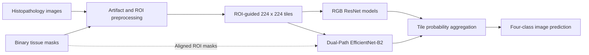

# Marcus.ai

### Breast Cancer Molecular Subtype Classification from Histopathology Images

**AN2DL — Second Challenge | December 2025 | PyTorch / Computer Vision**

Marcus.ai is a deep learning project for predicting **four breast cancer molecular subtypes** from low-magnification histopathology image patches. It explores artifact-aware preprocessing, region-of-interest (ROI) guided patch selection, and convolutional neural network classifiers that remain useful when images contain distracting background, staining variation, and acquisition artifacts.

This repository contains the **original team's project notebooks** and the **original report**, including its four-author attribution.

> **Project record:** [AN2DL — Second Challenge Report (PDF)](report/AN2DL_Second_Challenge_Report.pdf) · **Report date:** December 16, 2025

## At a glance

- **Task:** Four-class histopathology image classification.
- **Classes:** Luminal A, Luminal B, HER2(+), and Triple Negative.
- **Inputs:** RGB image regions extracted from low-magnification whole-slide images; associated tissue masks when used by the model.
- **Approach:** Remove artifacts → select tissue-rich 224 × 224 tiles → train CNN classifiers → aggregate tile-level probabilities into image-level predictions.
- **Metric:** Image-level **macro F1-score**, as reported in the project report.
- **Best reported test result:** **40.65% F1** with **Dual-Path EfficientNet-B2**.

## Method

### 1. Artifact-aware preprocessing and ROI-guided tiling

The team designed and experimented with multiple strategies for handling noisy histopathology images:

1. **Outlier detection:** Identify potentially corrupted/junk images based on HSV colors associated with atypical yellow/green/cyan artifacts, with manual inspection before removal.
2. **Stain-artifact cleanup:** Detect selected green and bright/shiny artifacts and replace problematic regions with a neutral gray/noisy background.
3. **Tissue-focused preprocessing:** Use the supplied binary ROI masks, along with masking and bounding-box cropping alternatives, to limit background bias.
4. **ROI-guided tiling:** Propose and select 224 × 224 tiles with relatively high tissue coverage.
5. **Quality filtering:** Exclude tiles with insufficient tissue or unusually low visual information.


*Preprocessing illustration reproduced from the original project report.*

### 2. Model architectures

| Model | Input | Core idea |
| --- | --- | --- |
| **ResNet50** | RGB tiles | ImageNet-pretrained ResNet with a regularized classification head and staged fine-tuning. |
| **ResNet101** | RGB tiles | Deeper pretrained ResNet with patch-level training and image-level validation. |
| **Dual-Path EfficientNet-B2** | RGB tiles **and** binary ROI masks | Separate RGB and mask encoders; concatenate their features and predict through a fusion classifier. |

The dual-path architecture combines **visual tissue texture** with **spatial information from the tissue mask**. The notebooks use PyTorch, pretrained torchvision backbones, weighted cross-entropy/label smoothing where configured, augmentation, and image-wise probability aggregation. The dual-path notebook additionally explores test-time augmentation (TTA).



## Results

The following numbers are transcribed from **Table 1 in the original project report**. They are reported challenge outcomes, **not independently reproduced benchmarks** from a fresh run of this repository.

| Model | Validation macro F1 | Test F1 |
| :--- | ---: | ---: |
| **Dual-Path EfficientNet-B2** | 41.20% | **40.65%** |
| ResNet50 (patch-based) | 43.64% | 40.26% |
| ResNet101 (patch-based) | **48.29%** | 39.47% |
| ResNet50 (without patching) | 39.37% | 35.85% |

**Interpretation:** ResNet101 achieved the highest reported validation F1; the dual-path EfficientNet-B2 obtained the highest reported test F1. The gap illustrates the difficulty of generalizing from validation to the hidden challenge test set.

| Validation macro F1 | Train/validation loss |
| :---: | :---: |
|  |  |

*Plots are taken from Figure 2 of the original report. Training loss is tile-level, whereas the report describes validation loss after image-level aggregation.*

## Repository contents

```text
marcus-ai-an2dl/
├── README.md
├── AUTHORS.md
├── CITATION.cff
├── SOURCE_INTEGRITY.md
├── requirements.txt
├── .gitignore
├── assets/
│   ├── preprocessing_overview.jpg
│   ├── validation_macro_f1.png
│   └── training_validation_loss.png
├── notebooks/
│   ├── preprocessing_code.ipynb  # Cleaning, masks, ROI tiles, quality filters
│   ├── Models_1.ipynb            # Dual-Path EfficientNet-B2
│   └── Models_2.ipynb            # ResNet101, ResNet50, inference, ensemble experiment
└── report/
    └── AN2DL_Second_Challenge_Report.pdf
```

## Getting started

These notebooks were originally written for **Google Colab**, with a GPU-enabled runtime and challenge-specific input data. They are shared as **research artifacts** rather than a fully packaged, one-command training system.

### Environment

Use a current Python 3 environment and a PyTorch/torchvision installation appropriate for your CUDA setup. Then install the other notebook dependencies:

```bash
python -m venv .venv
source .venv/bin/activate        # Windows: .venv\Scripts\activate
pip install -r requirements.txt
```

For Colab, install notebook dependencies in the runtime, mount Google Drive as needed, and enable a GPU. A **T4 GPU** is referenced in the original notebook metadata.

### Data requirements

The original challenge dataset is **not distributed in this repository**. You need authorized access to the original dataset, including:

- Training RGB images named `img_*.png` and corresponding ROI masks `mask_*.png`.
- Test images and masks for generating predictions.
- A `train_labels.csv` file associating `sample_index` filenames with their `label`.

The preprocessing notebook starts with an original challenge data archive. After preprocessing, the model notebooks expect artifacts such as:

```text
bbox_data_cleaned/
├── train_labels.csv
├── train_data/
├── test_data/
├── train_tiles_filtered/
└── test_tiles_filtered/
```

**Important:** Some cells assume that the cleaned archive has already been extracted into the **current Colab working directory** (so `train_labels.csv`, `train_tiles_filtered/`, and `test_tiles_filtered/` are directly available). Other cells refer to specific Google Drive paths. Before executing, inspect the path configuration in each notebook and adjust it to your authorized local/Colab dataset location.

### Suggested workflow

1. Open [`notebooks/preprocessing_code.ipynb`](notebooks/preprocessing_code.ipynb); provide the challenge dataset; inspect candidate outliers before executing removal cells. Preprocessing cells include **alternative experiments**, not a single entirely automated production pipeline.
2. Generate quality-filtered ROI tiles and the aligned masks. Check that training and test tile folders are populated and labels remain consistent.
3. Train the dual-path model from [`notebooks/Models_1.ipynb`](notebooks/Models_1.ipynb), or run the ResNet50/ResNet101 experiments from [`notebooks/Models_2.ipynb`](notebooks/Models_2.ipynb).
4. Validate at **image level** by combining predictions over each source image's tiles. Use the notebook's inference cells to create a challenge-format prediction CSV.

**Note:** Pretrained weights may be downloaded automatically. The historical notebook environment, dataset paths, and some intermediate files are not embedded in the repository; exact numerical reproduction may require additional setup. Saved `.pth` weights and challenge data are not included.

## Original project team

The following names appear together on the title page of the **original December 16, 2025 AN2DL Second Challenge Report**:

- **Amirali Askari**
- **Hamidreza Khodadadi**
- **Mohammad Rashid Khan Mofrad**
- **Zahra Nazar Zadeh Attar**

The report is preserved in [`report/AN2DL_Second_Challenge_Report.pdf`](report/AN2DL_Second_Challenge_Report.pdf), and the same authorship record is included in [`AUTHORS.md`](AUTHORS.md) and [`CITATION.cff`](CITATION.cff). Individual implementation responsibilities are not inferred from the report.

## Citation and attribution

If you reference this academic project, cite the original four-author **Marcus.ai — AN2DL Second Challenge Report (2025)**. GitHub can also display citation information from [`CITATION.cff`](CITATION.cff).

## Scope and usage

This is an **educational/research challenge project**, **not a clinical diagnostic system**. The repo does not supply raw patient images, challenge data, model checkpoints, or any clinical validation. There is **no open-source license specified** here; public readability does not itself grant reuse or redistribution rights. Confirm course/dataset-sharing rules and team permissions before publicly redistributing materials.
